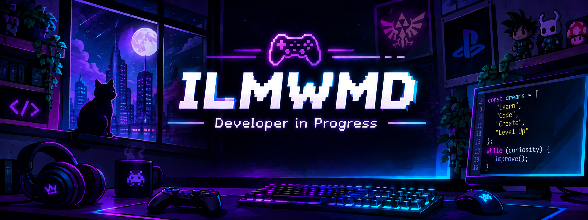

 
<!-- HEADER -->

  

# 👾 Hello, I'm ilmwmd!

### 🎮 Junior Developer | Web Development | Programming

*Learning, building and leveling up every day.*

---

## 🧑‍💻 About Me

- 🚀 Currently learning web development and programming.
- 🎨 Interested in creating modern and responsive interfaces.
- 💡 Exploring new technologies and improving my coding skills.
- 🎮 Passionate about videogames and technology.
- 🌱 Always learning something new.

---

## ⚡ Technologies & Tools

**Frontend**

**Programming & Tools**

---

### 🎯 Keep Learning. Keep Building. Keep Leveling Up.

  

